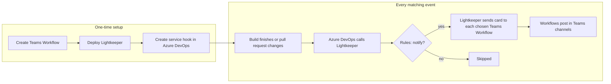
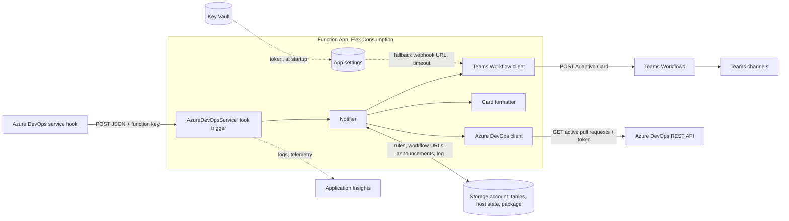
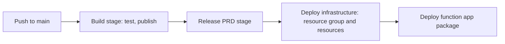
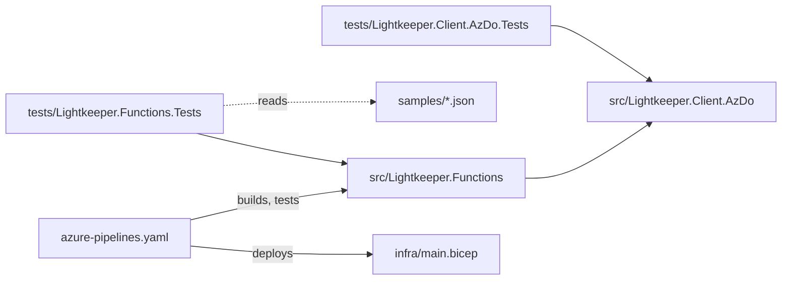

# <a id="about">ℹ️</a> About Lightkeeper

Lightkeeper is an open-source home for Azure DevOps automation, designed to receive webhooks and make API calls that help work move along. It posts Microsoft Teams channel messages when an Azure DevOps build finishes and when a pull request is ready for review. It runs as an Azure Function in your own Azure subscription, deployed by your own Azure Pipeline, with room to grow as the work requires.

## <a id="name">🗼</a> Why Lightkeeper?

A lighthouse keeper had two jobs: keep the light burning so passing ships got the signal they needed, and keep the station logbook so anyone could look back and see what happened and when.

Lightkeeper does the same for Azure DevOps. It watches for builds and pull requests and signals the right Teams channel when something needs attention, and it keeps a log of every event it handled. Pulling Azure DevOps Boards data together for reporting is the next part of the job.

No foghorn required.

## Action Items

*These are future identified items to be addressed. This includes items to allow flexibility to best match specific instances based on user or business needs.*

- [ ] Run saved WIQL queries on a schedule and store denormalized work item snapshots that Power BI can read without calling the Azure DevOps API on every refresh.
- [ ] Offer a one-command deployment (Azure Developer CLI) alongside the Azure Pipelines release.
- [ ] Script the one-time service connection role grants and service hook creation.

# <a id="contents">📖</a> Table of Contents

- [📃 Overview](#overview)
- [💻 Technical Overview](#technical)
- [📐 Architecture Summary](#architecture)
- [🧭 Notification Rules](#rules)
  - [How a rule decides](#rules-decide)
  - [Example](#rules-example)
  - [Adding a Teams Workflow](#rules-workflow)
  - [Notification log](#rules-log)
  - [Editing the tables](#rules-edit)
- [🚀 Run Locally](#run-locally)
- [☁️ Run in Hosted Environment (Azure Functions Flex Consumption)](#hosted)
  - [One-time setup](#hosted-setup)
  - [Deploy](#hosted-deploy)
  - [Verify and connect Azure DevOps](#hosted-verify)
- [⚙️ Development and Support](#development)
  - [Project structure](#structure)
  - [Extending Lightkeeper](#extending)
  - [Settings](#settings)

# <a id="overview">📃</a> Overview

When something happens in Azure DevOps, it can call a web address with the details. Lightkeeper is that web address: it checks the details, decides from a set of rules whether and where to notify, turns the details into a readable message card, and hands the card to one or more Teams Workflows, each posting to its own Teams channel.

| Term | Meaning |
| --- | --- |
| Service hook | An Azure DevOps subscription that sends event details as JSON to a web address when a chosen event happens. |
| Event | Something that happened in Azure DevOps, such as a build finishing (`build.complete`) or a pull request being created (`git.pullrequest.created`) or updated (`git.pullrequest.updated`). |
| Teams Workflow | A Power Automate workflow in Teams that accepts a card at a secret web address and posts it to a channel or chat. |
| Fallback workflow | The Teams Workflow in the `TeamsWorkflow__FallbackWebhookUrl` [setting](#settings), used when a rule names no workflow or the rule tables cannot be read. |
| Draft pull request | A pull request its author has not yet published for review. |
| Adaptive Card | The card format Teams renders natively: a tinted header, a list of labeled facts, and buttons. |
| Function key | A secret code the caller sends with each request so only Azure DevOps can use the hosted function. |
| Notification rule | A row in a table that says which events to notify about or skip, and which Teams Workflows get the card. Rules change without a release. |
| Active pull request list | A list of every active, non-draft pull request in a project, with the one just ready for review starred, which a rule can post instead of the pull request card. |
| Personal access token | An Azure DevOps password substitute with limited scopes, which Lightkeeper uses to read pull requests. Secret. |
| Key Vault | An Azure store for secrets. The hosted Function App reads its secrets from its own Key Vault when it starts. |



| Capability | Outcome | Limitation |
| --- | --- | --- |
| Build completed notification | A card headed by the result with an emoji and tint (✅ green, ⚠️ amber, ❌ red, ⏹️ gray), the pipeline and build number beneath, the finish time in each viewer's own time zone, and **View build** and **View pipeline** buttons stacked against the right edge of the header, then two columns of facts: project, branch, and repository beside requester, reason, and duration. | |
| Pull request ready for review | One 👀 card per pull request, the first time it arrives active and not a draft: when created ready, or when a draft is published. It shows the title, repository, source and target branches, creation time in each viewer's own time zone, project, number, author, reviewers (required first), and the description with its formatting (up to 600 characters; headings show as bold lines), with a **Review pull request** button. | Pushes, votes, and other later updates do not post again. Drafts, completed, and abandoned pull requests never post. |
| Active pull request list | With a rule's `NotificationType` set to `ActiveList`, the moment a pull request becomes ready for review posts one 👀 card listing every active, non-draft pull request in its project, up to 15, one block each: the others in the order they became ready for review, then the new one last with ⭐ before it. Each block shows the number and linked title across its full width; under it, with a **Review PR** button to the right, one wrapping line with 👤 author, 📅 the date it became ready for review in each viewer's own time zone (when it was announced, which for a published draft is when it was published; its created date if it was never announced) and the time since then in years, months, and days, such as `(7M)`, `(6M, 30d)`, or `(1Y, 2M, 3d)`, in red when over 2 business days (`Now` for the new pull request, and no age for others ready since the same day), 🌿 repository, and source → target branch; then resolved of total comment threads, with a green ✔ when all are resolved and a red ✔ otherwise; then required reviewers, ✅ when approved, with the members who approved for a group. The comment and reviewer lines appear only when there are any. | Needs the [personal access token](#settings). When Azure DevOps cannot supply the list, the pull request card posts instead. A pull request whose comments cannot be counted has no comment line, and the log `Detail` says how many. |
| Any other event | A 🔔 card (📋 for work items) for every other Azure DevOps event (work items, pushes, releases, and the rest), built from the summary Azure DevOps sends with it: its message, the project, the details, and an **Open in Azure DevOps** button when the event has a web link. | Rules can match only its trigger and project. Nothing posts until a rule includes that trigger. |
| Notification rules | Per organization and project, notify or skip by trigger, pipeline folder, pipeline name, and status (for example failures only), and send each event to one or several channels. Rules switch on and off without losing their settings. | The first matching rule decides, so one event follows one rule. Events no rule matches are skipped. |
| Notification log | One row per request: what arrived (including the full payload), which rule decided, and what each Teams Workflow answered. Kept 90 days by default. | |
| Delivery failure reporting | When any chosen Teams Workflow refuses the card, cannot be reached, or does not answer in time, Azure DevOps records a failed delivery in its service-hook history. The other workflows still get the card. | Success means every workflow accepted the card; whether Teams then shows it depends on the workflow. A failed delivery is not retried, which avoids duplicate posts. |

# <a id="technical">💻</a> Technical Overview

Versions are pinned in [global.json](global.json) (SDK, test runner, Functions project SDK) and [Directory.Packages.props](Directory.Packages.props) (NuGet packages). The target framework is set in [Directory.Build.props](Directory.Build.props).

| Element | Role | Where needed |
| --- | --- | --- |
| [.NET SDK](https://dotnet.microsoft.com/download/dotnet/10.0) | Build and test the C# isolated-worker application on .NET 10 (LTS). | local |
| [Visual Studio Code](https://code.visualstudio.com/) | Editor with tasks and a debug configuration for this repository. Opening the folder recommends the [Azure Functions](https://marketplace.visualstudio.com/items?itemName=ms-azuretools.vscode-azurefunctions), [C# Dev Kit](https://marketplace.visualstudio.com/items?itemName=ms-dotnettools.csdevkit), and [Azurite](https://marketplace.visualstudio.com/items?itemName=azurite.azurite) extensions. | optional |
| [Azure Functions Core Tools](https://learn.microsoft.com/azure/azure-functions/functions-run-local) | Run the Functions host locally. | local |
| [Azurite](https://learn.microsoft.com/azure/storage/common/storage-use-azurite) | Emulate the storage the Functions host and the notification tables use. | local |
| [Azure Storage Explorer](https://azure.microsoft.com/products/storage/storage-explorer/) | Edit notification rules and read the log, in Azurite or Azure. The Azure portal's Storage browser also works for Azure. | optional |
| [PowerShell 7](https://learn.microsoft.com/powershell/scripting/install/installing-powershell) | Run [Send-TestPayload.ps1](scripts/Send-TestPayload.ps1), which sends a sample event to the function. | local |
| [Azure Pipelines](https://learn.microsoft.com/azure/devops/pipelines/) | Build, test, and release each environment, deploying [Bicep](https://learn.microsoft.com/azure/azure-resource-manager/bicep/overview) infrastructure. | hosted |
| [Azure CLI](https://learn.microsoft.com/cli/azure/install-azure-cli) | One-time Azure setup and reading function keys. | hosted |
| [Azure Functions Flex Consumption plan](https://learn.microsoft.com/azure/azure-functions/flex-consumption-plan) | Host the function on Linux, scaling to zero when idle. | hosted |
| [Azure Storage account](https://learn.microsoft.com/azure/azure-functions/storage-considerations) | Hold the Functions host state, the deployment package, and the notification tables. | hosted |
| [Application Insights](https://learn.microsoft.com/azure/azure-functions/configure-monitoring) | Collect logs and telemetry through OpenTelemetry. Sends nothing when its setting is empty. | hosted, optional locally |
| [Teams Workflow webhook](https://support.microsoft.com/en-us/workflows/send-messages-in-teams-using-incoming-webhooks) | Accept cards and post them to the channel. Its owner must keep the workflow and its Teams connection working. | local, hosted |
| [Azure DevOps service hooks](https://learn.microsoft.com/azure/devops/service-hooks/services/webhooks) | Send `build.complete` events to the function over HTTPS. Needs project administrator rights to create. | hosted |
| [Azure Key Vault](https://learn.microsoft.com/azure/key-vault/general/overview) | Hold the Azure DevOps personal access token, loaded as settings when the Function App starts. | hosted |
| [Azure DevOps REST API](https://learn.microsoft.com/rest/api/azure/devops/git/pull-requests/get-pull-requests-by-project) | List a project's active pull requests and their comment threads for the [active pull request list](#overview), through [Lightkeeper.Client.AzDo](src/Lightkeeper.Client.AzDo/). | local, hosted |

# <a id="architecture">📐</a> Architecture Summary



| Part | Role | Local equivalent |
| --- | --- | --- |
| Function App | Runs the HTTP trigger at `POST /api/service-hooks/azure-devops`, protected by a function key. | The Functions host on `http://localhost:7071`, with no key required |
| App settings | Hold the fallback Teams Workflow URL, timeouts, log retention, and the Key Vault address. | `src/Lightkeeper.Functions/local.settings.json`, created from [local.settings.template.json](src/Lightkeeper.Functions/local.settings.template.json) and ignored by Git |
| Storage account | Host state, deployment package, and the [notification tables](#rules). | Azurite |
| Key Vault | The Azure DevOps personal access token, read once when the app starts. | `AzDo__PersonalAccessToken` in `local.settings.json` |
| Application Insights | Logs and telemetry. | Console output |
| Teams Workflows | Post the card to their channels. | The same workflows |

Each request gets a correlation ID that ties together its response, the calls to the workflows, its notification log row, and every log line. A caller-supplied `x-correlation-id` header is reused when it is 1 to 64 letters, digits, `.`, `_`, or `-`; otherwise the Functions invocation ID is used. The function answers with that header and JSON holding `outcome`, `detail`, and `correlationId`.

When several workflows get the card, the response reports the first one that failed.

| Outcome | HTTP status | Meaning |
| --- | --- | --- |
| `WorkflowAccepted` | 200 | Every chosen Teams Workflow accepted the card. |
| `Skipped` | 200 | A rule said not to notify, the event is not worth a card (such as a draft pull request), or the pull request was already announced. `detail` says which. |
| `InvalidPayload` | 400 | Body is not JSON, has no `eventType`, or lacks a required build or pull request field. `detail` names the problem. |
| `WorkflowRejected` | 502 | A workflow answered with a non-success status. |
| `WorkflowUnreachable` | 502 | A workflow could not be reached. |
| `WorkflowTimedOut` | 504 | A workflow did not answer within the timeout (15 seconds by default). |
| `WorkflowNotConfigured` | 500 | A rule names a workflow ID with no https URL in the `TeamsWorkflow` table. |

# <a id="rules">🧭</a> Notification Rules

Lightkeeper uses four tables in its storage account, creating them on first use. Rules and workflow URLs are read on every event, so an edit applies to the next event with no release or restart.

| Table | Holds |
| --- | --- |
| `NotificationRule` | Which events to notify about or skip, and where to send them. |
| `TeamsWorkflow` | Teams Workflow URLs by ID, so rules name a channel without containing its secret URL. |
| `NotificationAnnouncement` | One row per pull request already announced (PartitionKey organization, RowKey `pullrequest-<repository ID>-<number>`), so it posts only once. `AnnouncedUtc` is when it was announced, which the [active pull request list](#overview) shows as the date it became ready for review; a row without it uses its write time. Delete a row to announce that pull request again on its next update. |
| `NotificationLog` | One row per request, for history and troubleshooting. |

## <a id="rules-decide">How a rule decides</a>

1. A draft, completed, or abandoned pull request is skipped before any rule is read. Otherwise Lightkeeper loads the rows whose `Active` column is `true` and keeps those whose filled-in match columns all match the event. An empty column matches anything. Any other row is ignored, so turning `Active` off keeps a rule's settings without using it.
2. The rule with the lowest `Priority` number wins; equal priorities go to the alphabetically first `RuleId`.
3. A winning `Exclude` rule skips the event. A winning `Include` rule sends the card to each workflow in its `Workflow` column: the event's own card, or for a pull request with `NotificationType` `ActiveList`, the [active pull request list](#overview) instead.
4. With no matching rule, the event is skipped. Only when the rules cannot be read does the card go to the [fallback workflow](#overview), so a storage problem cannot silence notifications.
5. A pull request already in `NotificationAnnouncement` is skipped even when a rule says to notify.

| `NotificationRule` column | Values | Matching |
| --- | --- | --- |
| PartitionKey | Azure DevOps organization, such as `fabrikam` | Wildcards allowed; `*` is every organization. |
| RowKey | Rule ID, such as `prd-failures` | Names the rule in the log. |
| `Active` | `true` to evaluate the row (Boolean). Missing or any other value turns the row off. | |
| `Project` | Azure DevOps project, such as `Fabrikam Fiber` | Wildcards allowed. |
| `Priority` | Whole number (`Int32`); lower runs first | |
| `Trigger` | Event type, such as `build.complete` (**Build completed** in Azure DevOps), `git.pullrequest.created` (**Pull request created**), `git.pullrequest.updated` (**Pull request updated**), or any other ID from the [event reference](https://learn.microsoft.com/azure/devops/service-hooks/events), such as `workitem.updated` | Wildcards allowed; `git.pullrequest.*` is both pull request events. |
| `Folder` | Builds: the pipeline folder. Pull requests: the target branch, such as `main` or `release/**`. `\prd` is that folder only. `\qa\**` is `\qa` and everything under it. `\beta-*` is any folder starting with `beta-`. `\` is the root only. `**` is any folder. | `/` works the same as `\`. |
| `Pipeline` | Builds: the pipeline name, such as `*PR *`, `*Playwright*`, `[Pricing] Release`. Pull requests: the repository name. | Wildcards allowed. |
| `Status` | Builds: a list of `Succeeded`, `Partially Succeeded`, `Failed`, `Stopped`, separated by commas. Pull requests are always `Active` by the time rules run. A leading `!` means anything except the list. | `!Succeeded` and `Partially Succeeded, Failed, Stopped` match the same builds. |
| `Action` | `Include` or `Exclude` | |
| `Workflow` | `TeamsWorkflow` IDs separated by `;`, such as `team-prd; team-qa`. `fallback` is the [fallback workflow](#overview). Empty means `fallback`. | Include rules only. |
| `NotificationType` | `Card` posts the event's own card. `ActiveList` posts the [active pull request list](#overview) for the event's organization and project instead of the pull request card, for `git.pullrequest.*` events only; any other event still gets its own card. Empty, missing, or unrecognized means `Card`, and an unrecognized value is logged as a warning. | Include rules only. |
| `Note` | Free text: why the rule exists | |

Wildcards: `*` matches within one folder level, `**` matches any number of levels, `?` matches one character, and everything else, including `[ ]`, is literal. Matching ignores case. A row with a missing `Priority` or an unknown `Action` is ignored and logged as a warning.

| `TeamsWorkflow` column | Values |
| --- | --- |
| PartitionKey | Always `workflow` |
| RowKey | Workflow ID that rules use, such as `team-prd` |
| `Channel` | Free text: which team and channel it posts to |
| `Url` | The workflow's https URL from its **When a Teams webhook request is received** trigger. Secret. |

## <a id="rules-example">Example</a>

| PartitionKey | RowKey | Active | Project | Priority | Trigger | Folder | Pipeline | Status | Action | Workflow | NotificationType |
| --- | --- | --- | --- | --- | --- | --- | --- | --- | --- | --- | --- |
| fabrikam | pr-checks | true | Fabrikam Fiber | 10 | build.complete | `**` | `*PR *` | | Exclude | | |
| fabrikam | prd-failures | true | Fabrikam Fiber | 30 | build.complete | `\prd` | | `!Succeeded` | Include | `team-prd; team-qa` | |
| fabrikam | playwright | true | Fabrikam Fiber | 40 | build.complete | `\beta-*` | `*Playwright*` | `Failed` | Include | `team-qa` | |
| fabrikam | all-failures | true | Fabrikam Fiber | 900 | build.complete | `**` | | `!Succeeded` | Include | | |
| fabrikam | pr-ready | true | Fabrikam Fiber | 50 | `git.pullrequest.*` | | | | Include | `team-prs` | |
| fabrikam | pr-queue | true | Fabrikam Fiber | 45 | `git.pullrequest.*` | `release/**` | | | Include | `team-qa` | ActiveList |
| fabrikam | opt-in | false | Fabrikam Fiber | 9998 | | `**` | | | Include | | |

| Event | Winning rule | Result |
| --- | --- | --- |
| `\Pricing\[Pricing] PR Checks` failed | pr-checks (10) | Skipped, even though `all-failures` would match. |
| `\prd\fabrikam-backend PRD` succeeded | none | Skipped (no rule): `prd-failures` and `all-failures` need a status other than Succeeded, and `opt-in` is off. |
| `\prd\fabrikam-backend PRD` failed | prd-failures (30) | Posted to both `team-prd` and `team-qa`. |
| `\beta-dev\[beta-dev] Playwright E2E Tests` partially succeeded | all-failures (900) | Posted to the fallback workflow: `playwright` needs `Failed`. |
| Pull request created as a draft, then published | pr-ready (50) for the publish | The draft is skipped (`Skip (draft)`); publishing posts to `team-prs`; later pushes and votes are skipped (`Skip (pr-ready, already announced)`). |
| Pull request into `release/2026.12` published | pr-queue (45) | Posted to `team-qa` as the list of active, non-draft pull requests in Fabrikam Fiber, with this one starred. Pull requests into other branches still post their own card through `pr-ready`. |
| Any build while debugging with `opt-in` set to `true` | opt-in (9998), unless a lower number matches first | Posted to the fallback workflow, so every event not otherwise handled shows up. |
| Any build in a project with no rules | none | Skipped (no rule). |

## <a id="rules-workflow">Adding a Teams Workflow</a>

Each channel or chat that receives cards needs its own workflow. Build it from blank rather than from a Teams template: a template-based workflow adds "*name* used a Workflow template to send this card" under every card. Whoever creates the workflow owns it, and it stops posting if that person loses access to the channel.

1. [Power Automate](https://make.powerautomate.com) › **+ Create › Instant cloud flow** › name it after its `TeamsWorkflow` ID, such as `team-prs` › trigger **When a Teams webhook request is received** › **Create**.
2. In the trigger, set **Who can trigger the flow** to `Anyone`.
3. Add the action **Post card in a chat or channel** and set the fields in the table below.
4. **Save**, then copy the trigger's **HTTP URL**. The same place shows it again later.

| Field | Channel | Yourself, such as the [fallback workflow](#overview) |
| --- | --- | --- |
| Post as | `Flow bot` | `Flow bot` |
| Post in | `Channel`, then pick **Team** and **Channel** | `Chat with Flow bot`, then **Recipient** yourself. Cards arrive in your Teams chat named **Workflows**; Teams cannot post to your chat with yourself. |
| Adaptive Card | **fx** › `triggerBody()?['attachments']?[0]?['content']` › **Add** | The same expression |

A channel workflow's URL goes in the `Url` column of a `TeamsWorkflow` row ([editing the tables](#rules-edit)), and a rule names that row's ID in its `Workflow` column. The fallback workflow's URL goes in the `a_TeamsWorkflowFallbackWebhookUrl` [pipeline variable](#hosted-pipeline-variables) instead and reaches the app at the next release.

## <a id="rules-log">Notification log</a>

PartitionKey is the UTC date (`2026-11-21`) and RowKey is the UTC time followed by the correlation ID, so rows sort by arrival. Rows older than `NotificationLog__RetentionDays` (90 by default) are deleted daily at 03:15 UTC.

| Column | Contents |
| --- | --- |
| `ReceivedUtc`, `CorrelationId`, `DurationMs` | When the request arrived, its correlation ID, and how long Lightkeeper took. |
| `Trigger`, `Organization`, `Project`, `Pipeline`, `Reference`, `Status` | The event: type, where it came from, what it is about (a build's `\folder\name`, or a pull request's `repository · source → target`), the build number or pull request number (`!42`), and status. Empty when the payload could not be read. |
| `RuleId`, `RulePriority`, `RuleAction` | The winning rule, if any. |
| `Decision` | `Notify (<RuleId>)`, `Skip (<RuleId>)`, `Skip (no rule)`, `Skip (draft)`, `Skip (completed)`, `Skip (abandoned)`, `Skip (<RuleId>, already announced)`, `Notify (rules unreadable)`, `Notify (<RuleId>, workflows unreadable)`, or `Notify (<RuleId>, active list unavailable)` (the pull request card was posted instead, and `Detail` says why). Empty when the event never reached the rules. |
| `Workflow`, `Outcome` | Workflow IDs and one [outcome](#architecture) for each, in the same order, separated by `;`. Without a delivery, `Outcome` is the overall outcome, such as `Skipped`. |
| `HttpStatus`, `Detail` | What Lightkeeper answered Azure DevOps. |
| `Payload` | The request body exactly as received (JSON text). A body over 32,000 characters continues in `Payload2`, `Payload3`, and so on; past 384,000 characters the rest is dropped and `PayloadTruncated` is `true`. |

## <a id="rules-edit">Editing the tables</a>

Tables have no fixed columns: a column such as `NotificationType` shows only once some row has a value in it. To set one on an existing rule, select the row › **Edit** › **Add property**, enter the column name, type (**String** unless the column table says otherwise), and value, then **Update**. Rules are read on every event, so no restart is needed.

| Where | How |
| --- | --- |
| Azure | Portal: **Storage account `<base>st` › Storage browser › Tables › table › Add entity**. Add `Priority` with type **Int32**. Shared-key access is disabled, so each editor needs **Storage Table Data Contributor** (rules) or **Storage Table Data Reader** (log only); grant it on a single table so rule editors do not see `TeamsWorkflow` URLs. Portal: **Storage account › Access control (IAM) › Add role assignment**, scoped to the account. Command line, scoped to one table: `az role assignment create --assignee <user> --role "Storage Table Data Contributor" --scope "$(az storage account show -n <base>st --query id -o tsv)/tableServices/default/tables/NotificationRule"`. |
| Local | Azure Storage Explorer › **Emulator & Attached › Storage Accounts › (Emulator - Default Ports) › Tables**, with Azurite running. The tables appear after the first event. |

# <a id="run-locally">🚀</a> Run Locally

Install the local tools from the [Technical Overview](#technical) first. On Windows: `winget install Microsoft.Azure.FunctionsCoreTools` and `npm install -g azurite`. Commands run from the repository root unless the step says otherwise.

| Step | Command line | Visual Studio Code | Expected result |
| --- | --- | --- | --- |
| Create local settings | `Copy-Item src/Lightkeeper.Functions/local.settings.template.json src/Lightkeeper.Functions/local.settings.json`, then paste the fallback Teams Workflow URL into `TeamsWorkflow__FallbackWebhookUrl`, and for `ActiveList` rules a [personal access token](#hosted-token) into `AzDo__PersonalAccessToken` | Copy [local.settings.template.json](src/Lightkeeper.Functions/local.settings.template.json) to `local.settings.json` in the same folder, then paste the values | [Adding a Teams Workflow](#rules-workflow) shows where the URL comes from. |
| Start the host | `azurite --silent --location .azurite` in one terminal, then `func start` from `src/Lightkeeper.Functions` in another | **Run and Debug › Lightkeeper: start host and attach** starts Azurite and the host, then asks for a process: pick the `dotnet` process whose command line ends in `Lightkeeper.Functions.dll` | The output lists `AzureDevOpsServiceHook: [POST] http://localhost:7071/api/service-hooks/azure-devops`. A missing or non-https URL stops the worker with `OptionsValidationException` naming `TeamsWorkflow:FallbackWebhookUrl`. |
| Send a sample event | `./scripts/Send-TestPayload.ps1`, or add `-PayloadPath samples/build.complete.minimal.json` for Microsoft's shorter build sample, or `-PayloadPath samples/git.pullrequest.created.json` for a pull request | **Terminal › Run Task › Send test payload** | `StatusCode : 200` and `"outcome":"WorkflowAccepted"`, then a green **✅ Build succeeded** card for **MainRepo (1) · 20241202.1** in the channel. The samples are Microsoft's official events, kept in [samples](samples/). |
| <a id="preview-cards">Preview every card type</a> | `./scripts/Send-CardPreviews.ps1 [-ActiveListOrganization '<orgname>' -ActiveListProject '<projectname>']` | **Terminal › Run Task › Send card previews** | One card of each kind (build succeeded, partially succeeded, failed, stopped, minimal; pull request ready; work item updated; code pushed, standing in for every other event) arrives from the fallback workflow, and the table shows `200 WorkflowAccepted` for each. The script starts Azurite and the Functions host in their own windows if they are not running and stops the host it started once the cards are sent, so each run uses the latest code (a host that was already running is used as is), works only against `localhost`, and adds a local `card-preview` rule (priority 0, every event, Include) to Azurite, so set `TeamsWorkflow__FallbackWebhookUrl` to a workflow that posts only to you, such as your Flow bot chat. Azure DevOps and the hosted tables are not involved. To also preview the [active pull request list](#overview), add the bracketed arguments and set `AzDo__PersonalAccessToken`: the script reads that project's active pull requests, announces the newest one that is not a draft, so it is starred and shows `Now`, and adds a local `card-preview-active-list` rule (priority -1, that project, `git.pullrequest.*`, `ActiveList`). It only reads from Azure DevOps. |
| Stop | Ctrl+C in both terminals | **Terminal › Terminate Task** for both tasks | |

Azure DevOps delivery is tested against the hosted function since a live service hook cannot reach `localhost`.

# <a id="hosted">☁️</a> Run in Hosted Environment (Azure Functions Flex Consumption)

Azure Pipelines builds and deploys everything. [azure-pipelines.yaml](azure-pipelines.yaml) builds and tests on every push to `main`, then runs [azure-pipelines-release.yaml](azure-pipelines-release.yaml) once per environment (only `PRD` today). Each release deploys [main.bicep](infra/main.bicep), which creates the resource group and deploys [resources.bicep](infra/resources.bicep) into it, then deploys the function package.



| Term | Meaning |
| --- | --- |
| Service connection | An Azure DevOps project object that lets a pipeline sign in to Azure as a Microsoft Entra identity. That identity needs Azure roles to create resources. |
| Managed identity | An identity Azure gives a resource. The Function App uses its own to reach its storage account, so no storage keys exist. |
| Variable group | A named set of pipeline variables in Azure DevOps **Pipelines › Library**. Secret values in a group are hidden from logs. |
| Environment | An Azure DevOps deployment target named `<App> <ENV>`, such as `Lightkeeper PRD`, where approvals and checks can be added. |
| Environment code | `PRD`, `DMO`, `UAT`, `QAT`, or `DEV`, the only codes [main.bicep](infra/main.bicep) accepts. |

<a id="naming">Resource names</a> are `<base><suffix>`, where `<base>` is the app base name, the environment code in lowercase, and a region code (for example `lkcontoso` + `prd` + `useast2`). Storage account, Key Vault, and Function App names are globally unique across Azure, so each copy picks an app base name of its own (2 to 11 characters) when it creates its [variable groups](#hosted-variables). The region code is 2 to 8 characters, which keeps every name within Azure's 24-character limit.

| Resource | Name | Notes |
| --- | --- | --- |
| Resource group | `<base>rg` | Created by the release in the chosen Azure region. |
| Storage account | `<base>st` | Host state and deployment package. Shared-key access is disabled; the app uses its managed identity. |
| Key Vault | `<base>kv` | Secrets the app loads at startup. Access is by Azure role: the app's managed identity gets **Key Vault Secrets User**, and each user in `a_KeyVaultSecretsOfficers` gets **Key Vault Secrets Officer**. The release only adds role assignments, so access granted in the portal survives each release. The name must be globally unique. |
| Log Analytics workspace and Application Insights | `<base>oiw` | One name for both. |
| Flex Consumption plan | `<base>fcnasp` | Linux, FC1. |
| Function App | `<base>fcn` | .NET 10 isolated, 2,048 MB instances, system-assigned managed identity. |

Every resource gets three tags: `Product`, `Environment`, and `CreatedBy`.

## <a id="hosted-setup">One-time setup</a>

Needs Azure DevOps project administrator rights, and **Owner** (or **Contributor** plus **User Access Administrator**) on the target Azure subscription. Do the steps in order. A new environment repeats only the variable group and environment steps.

| Step | Where | What to do |
| --- | --- | --- |
| Register resource providers | Azure | Usually already done for a subscription. Command line: `foreach ($ns in 'Microsoft.Web','Microsoft.Storage','Microsoft.KeyVault','Microsoft.OperationalInsights','Microsoft.Insights') { az provider register --namespace $ns --wait }`. Portal: **Subscription › Settings › Resource providers**. |
| <a id="hosted-connection">Create the service connection</a> | Azure DevOps | **Project settings › Service connections › New service connection › Azure Resource Manager › App registration (automatic)**, credential **Workload identity federation**, scope **Subscription** with no resource group. Name it `sc-[{env}-]lightkeeper`, where the bracketed part is optional and `{env}` is a lowercase environment code (`sc-lightkeeper` for one shared connection, `sc-prd-lightkeeper` for one per environment). Leave **Grant access permission to all pipelines** unchecked. If the tenant blocks app registration, choose **Managed identity** with a user-assigned identity instead. An existing connection also works once its identity gets the roles in the next step. |
| <a id="hosted-grants">Grant the connection's identity roles</a> | Azure | **Contributor** and **User Access Administrator** on the subscription, so each release can create the resource group and grant the Function App's identity its storage roles. Command line: the script below the table. Portal, once per role: **Subscription › Access control (IAM) › Add › Add role assignment › Privileged administrator roles › role › Members › Select members** › the identity, named `<organization>-<project>-<service connection ID>` (the ID is `resourceId` in the browser address with the connection open in Azure DevOps) › **Review + assign**. For User Access Administrator, keep the recommended condition that blocks assigning privileged roles. |
| <a id="hosted-variables">Create the variable groups</a> | Azure DevOps | **Pipelines › Library › + Variable group**: `lightkeeper-vars` and `lightkeeper-prd-vars`, with the [pipeline variables](#hosted-pipeline-variables) listed after this table. Mark `a_TeamsWorkflowFallbackWebhookUrl` secret (lock icon). Leave pipeline access unchecked. |
| Create the environment | Azure DevOps | **Pipelines › Environments › New environment**: `Lightkeeper PRD`, resource **None**. Add **Approvals and checks** there if releases should wait for approval. |
| Create the pipeline | Azure DevOps | **Pipelines › New pipeline › GitHub** or **Azure Repos Git** › the repository › **Existing Azure Pipelines YAML file** › `/azure-pipelines.yaml` › **Save**. A private GitHub repository connects through the Azure Pipelines GitHub App: approve its installation for the repository when GitHub asks, or add the repository later on GitHub under **Settings › Applications › Installed GitHub Apps › Azure Pipelines › Configure**. |
| Run it the first time | Azure DevOps | **Run pipeline**, then **Permit** each prompt for the variable groups, the service connection, and the environment. |
| <a id="hosted-token">Store the personal access token</a> | Azure DevOps, then Azure | Needed only for `ActiveList` rules. In Azure DevOps: **User settings › Personal access tokens › New Token**, organization **All accessible organizations** (or the one organization), scope **Code › Read**. Then, as a user in `a_KeyVaultSecretsOfficers`: `az keyvault secret set --vault-name <base>kv --name AzDo--PersonalAccessToken --value <token>` and `az functionapp restart -g <base>rg -n <base>fcn`. Portal: **Key Vault › Objects › Secrets › Generate/Import**. The app reads secrets only when it starts, so restart it after every change, including renewing the token before it expires. |

```powershell
$scope = '/subscriptions/<subscription-id>'
# Client ID of the connection's identity, then its object ID
$clientId = az devops service-endpoint list --org <org-url> --project '<project>' --query "[?name=='<connection>'].authorization.parameters.serviceprincipalid" -o tsv
$principal = az ad sp show --id $clientId --query id -o tsv
az role assignment create --assignee-object-id $principal --assignee-principal-type ServicePrincipal --role Contributor --scope $scope
az role assignment create --assignee-object-id $principal --assignee-principal-type ServicePrincipal --role 'User Access Administrator' --scope $scope
```

<a id="hosted-pipeline-variables">Pipeline variables</a>, required unless marked optional:

| Variable | Group | Purpose | Sample value |
| --- | --- | --- | --- |
| `a_AzureServiceConnection` | `lightkeeper-vars` | Name of the [service connection](#hosted-connection). | `sc-lightkeeper` |
| `a_AzureSubscriptionId` | `lightkeeper-vars` | Subscription that holds the resource group. | A subscription ID |
| `a_AppBase` | `lightkeeper-vars` | First part of every [resource name](#naming) and the `Product` tag. Lowercase letters and digits, 2 to 11 characters, unique to your deployment. | `lkcontoso` |
| `a_Region` | `lightkeeper-<env>-vars` | Region code in [resource names](#naming). | `useast2` |
| `a_Location` | `lightkeeper-<env>-vars` | Azure region for the resource group and its resources. | `eastus2` |
| `a_TeamsWorkflowFallbackWebhookUrl` | `lightkeeper-<env>-vars` | The [fallback workflow](#overview) URL, set as the Function App's `TeamsWorkflow__FallbackWebhookUrl`. Secret. | None |
| `a_KeyVaultSecretsOfficers` | `lightkeeper-<env>-vars` | Optional. Microsoft Entra ID users who may set Key Vault secrets, as sign-in names or object IDs separated by `;`. Object IDs always work: get your own with `az ad signed-in-user show --query id -o tsv`, or another user's from **Microsoft Entra ID › Users › user › Object ID**. Sign-in names work only when the service connection's identity has Microsoft Graph `User.Read.All` (application permission, granted by an Entra admin); without it the release fails at **Deploy infrastructure** with `Insufficient privileges to complete the operation`. Removing a user here does not revoke access: remove the role assignment in **Key Vault › Access control (IAM)**. Not secret. | `pat.lee@contoso.com; <object ID>` |

## <a id="hosted-deploy">Deploy</a>

Push to `main`, or run the pipeline by hand. The **Deploy infrastructure** step ends with `Key Vault: <base>kv` and `Function endpoint: https://<app-host-name>/api/service-hooks/azure-devops`. A setting changed in the portal lasts only until the next release, since each release rewrites the Function App's full app-settings list from [resources.bicep](infra/resources.bicep).

## <a id="hosted-verify">Verify and connect Azure DevOps</a>

| Step | How | Expected result |
| --- | --- | --- |
| Get the function key | `az functionapp function keys list -g <base>rg -n <base>fcn --function-name AzureDevOpsServiceHook --query default -o tsv`. Portal: **Function App › Functions › AzureDevOpsServiceHook › Function Keys**. | A key string. Treat it as a secret. |
| Send a sample event | `./scripts/Send-TestPayload.ps1 -Uri https://<app-host-name>/api/service-hooks/azure-devops`, pasting the key at the prompt | The same result and card as [running locally](#run-locally). A request without the key returns 401. |
| Create the service hooks | **Project settings › Service hooks › Create subscription › Web Hooks**, once per trigger: **Build completed**, **Pull request created**, and **Pull request updated** (Repository and Target branch **[Any]**; for updated, Change **[Any]**). Each uses URL `https://<app-host-name>/api/service-hooks/azure-devops`, HTTP headers `x-functions-key:<function key>`, Resource details to send **All**, Messages and Detailed messages **All** › **Test**. | Each test shows Lightkeeper's 200 response. Azure DevOps tests send Microsoft's sample project, so they log `Skip (no rule)` unless a rule matches it. With fewer resource details, required fields can be missing and the event returns 400. |
| Watch real events | **Finish**, then run a matching build or publish a pull request | **Service hooks › History** shows each delivery and Lightkeeper's response. |

# <a id="development">⚙️</a> Development and Support

| Task | Command line (repository root) | Visual Studio Code |
| --- | --- | --- |
| Build | `dotnet build` | **Solution Explorer** › right-click **Lightkeeper** › **Build** |
| Test | `dotnet test` | **Terminal › Run Task › Tests: run** |
| Run | `func start` from `src/Lightkeeper.Functions`, with Azurite running | **Run and Debug › Lightkeeper: start host and attach** |
| Send a sample event | `./scripts/Send-TestPayload.ps1` | **Terminal › Run Task › Send test payload** |
| Preview every card type | `./scripts/Send-CardPreviews.ps1 [-ActiveListOrganization '<orgname>' -ActiveListProject '<projectname>']` ([details](#preview-cards)) | **Terminal › Run Task › Send card previews** |
| Release | Push to `main` | **Source Control › Sync Changes** on `main` |

Tests use Microsoft Testing Platform with xUnit v3 and run without the Functions host. They cover the failures that would lose, misroute, or misreport a notification: card mapping against the [official samples](samples/), draft and closed pull requests, announcing a pull request once (and again after a failed delivery), rule matching on real folder and pipeline names, priority order, status lists, delivery to several workflows, unreadable or misconfigured tables, table row mapping including large payloads, malformed or incomplete payloads, a workflow that rejects, times out, or cannot be reached (each must reach Azure DevOps as a failure), a missing or non-https webhook URL, caller-supplied correlation IDs, the active pull request list (block contents, the starred pull request, review buttons, ages and business-day overdue, drafts left out, reviewer approvals, comment counts, staying under the Teams message size, and posting the pull request card when Azure DevOps cannot supply the list), and the Azure DevOps client's paging, reviewer and comment thread mapping, token authentication, and refused, timed-out, or unreachable calls. How the real workflow renders a card, how the host binds the triggers, and reads and writes against Table Storage are checked by sending a sample event, [locally](#run-locally) or [hosted](#hosted-verify).

| Topic | Detail |
| --- | --- |
| Your own copy | Fork the repository, then follow [Run in Hosted Environment](#hosted) with your own app base name, subscription, and Teams Workflows. Nothing in the repository is tied to one organization. |
| Taking updates | Use GitHub's **Sync fork** on `main`. Each push to `main` in your copy deploys it. |
| Contributing | Branch `feature/*` from `main` and open a pull request into it. Run `dotnet test` first. |
| Security | Report a vulnerability privately through the repository's **Security › Report a vulnerability**, not in an issue. Never put a webhook URL, token, or function key in an issue, sample, or test. |
| Ownership | Maintained by Hans Dickel ([geekfog](https://github.com/geekfog)). |
| Support | [GitHub Issues](https://github.com/geekfog/Lightkeeper/issues). |
| License | [GNU General Public License v3.0](LICENSE). |

## <a id="structure">Project structure</a>



| Folder in [src/Lightkeeper.Functions](src/Lightkeeper.Functions/) | Responsibility |
| --- | --- |
| [Triggers](src/Lightkeeper.Functions/Triggers/) | HTTP entry point (correlation ID, call the notifier, map outcome to status code, write the log row) and the daily log retention timer. |
| [Notifications](src/Lightkeeper.Functions/Notifications/) | Parse the event, format its card, apply the rules, deliver to each workflow, and report the outcome and log entry. |
| [Routing](src/Lightkeeper.Functions/Routing/) | Rule matching: wildcard patterns, status lists, and priority order. No I/O. |
| [Cards](src/Lightkeeper.Functions/Cards/) | Adaptive Card model, shared display rules and card layout, and one formatter per event type, which also extracts the facts rules match against. |
| [Integrations/TeamsWorkflow](src/Lightkeeper.Functions/Integrations/TeamsWorkflow/) | Teams Workflow options and HTTP client. Never logs a webhook URL. |
| [Integrations/TableStorage](src/Lightkeeper.Functions/Integrations/TableStorage/) | The four tables: names, columns, row mapping, and log retention. |
| [Models](src/Lightkeeper.Functions/Models/) | Service-hook event, build and pull request resources, and shared JSON settings. |
| [Configuration](src/Lightkeeper.Functions/Configuration/) | Dependency registration, setting names, and loading Key Vault secrets at startup. |
| [Diagnostics](src/Lightkeeper.Functions/Diagnostics/) | Correlation ID rules. |

[src/Lightkeeper.Client.AzDo](src/Lightkeeper.Client.AzDo/) is the Azure DevOps REST client: its `AzDo` settings, web and API addresses, and a typed `HttpClient` that lists a project's active pull requests and counts a pull request's comment threads. It does not depend on the Functions project.

The hosting plan is Flex Consumption, which runs only on Linux.

## <a id="extending">Extending Lightkeeper</a>

| Change | What to do |
| --- | --- |
| Richer card for an event | Every event already gets the general card. For a card of its own, add the event ID to `ServiceHookEventTypes` in [ServiceHookEvent.cs](src/Lightkeeper.Functions/Models/ServiceHookEvent.cs) and a resource model in [Models](src/Lightkeeper.Functions/Models/), based on the event's sample in the [service-hook event reference](https://learn.microsoft.com/azure/devops/service-hooks/events). Add an `IServiceHookCardFormatter` in [Cards](src/Lightkeeper.Functions/Cards/) that returns the card and its rule facts (or a skip reason, and an announce-once key when the card should post only once per subject), and register it in [ServiceCollectionExtensions.cs](src/Lightkeeper.Functions/Configuration/ServiceCollectionExtensions.cs). Save the official sample in [samples](samples/) and add formatter tests. |
| New environment | Add one `template:` block to [azure-pipelines.yaml](azure-pipelines.yaml), a `lightkeeper-<env>-vars` [variable group](#hosted-variables), and a `Lightkeeper <ENV>` environment. |
| New hosted app setting | Add it to the app settings in [resources.bicep](infra/resources.bicep), not the portal. |
| New Azure DevOps REST call | Add a method to `IAzDoClient` in [IAzDoClient.cs](src/Lightkeeper.Client.AzDo/IAzDoClient.cs) returning `AzDoResult<T>`, its address in [AzDoUrls.cs](src/Lightkeeper.Client.AzDo/AzDoUrls.cs), and tests in [tests/Lightkeeper.Client.AzDo.Tests](tests/Lightkeeper.Client.AzDo.Tests/). If it needs more than **Code › Read**, the [personal access token](#hosted-token) needs that scope too. |
| New secret | Add a Key Vault secret named after the setting with `--` in place of each `__`, such as `AzDo--PersonalAccessToken` for `AzDo__PersonalAccessToken`, then restart the Function App. |

## <a id="settings">Settings</a>

Application settings read by the function. Values entered during hosted setup are the [pipeline variables](#hosted-pipeline-variables).

| Setting | Purpose | Local (`local.settings.json`) and default | Hosted (Function App app setting) | Required |
| --- | --- | --- | --- | --- |
| `TeamsWorkflow__FallbackWebhookUrl` | Secret https URL of the [fallback workflow](#overview), used when an Include rule names `fallback` or no workflow, or when the rule tables cannot be read. Never logged. | Empty; enter it yourself | Same name, from `a_TeamsWorkflowFallbackWebhookUrl` at release | Yes |
| `TeamsWorkflow__Timeout` | How long to wait for each workflow, from `00:00:01` to `00:02:00`. | `00:00:15` | Not set, so `00:00:15`; to change it, add it to [resources.bicep](infra/resources.bicep) | No |
| `NotificationLog__RetentionDays` | Days to keep [notification log](#rules-log) rows, from 1 to 3650. | `90` | Not set, so `90`; to change it, add it to [resources.bicep](infra/resources.bicep) | No |
| `AzDo__PersonalAccessToken` | Secret Azure DevOps [personal access token](#hosted-token) with **Code › Read**, used by `ActiveList` rules. Empty makes those rules post the pull request card instead. Never logged. | Empty; enter it yourself | Key Vault secret `AzDo--PersonalAccessToken`, set by hand | No |
| `AzDo__Timeout` | How long to wait for each Azure DevOps call, from `00:00:01` to `00:02:00`. | `00:00:30` | Not set, so `00:00:30`; to change it, add it to [resources.bicep](infra/resources.bicep) | No |
| `KeyVault__Uri` | Key Vault whose secrets are loaded as settings when the app starts, using the app's managed identity. Secrets override app settings of the same name. Empty skips Key Vault. | Empty | Set by the release to `https://<base>kv.vault.azure.net/` | No |
| `APPLICATIONINSIGHTS_CONNECTION_STRING` | Enables OpenTelemetry export to Application Insights. Empty disables it. | Empty | Set by the release from Application Insights | No |
| `AzureWebJobsStorage` | Functions host storage, also used for the notification tables. | `UseDevelopmentStorage=true` (Azurite) | Replaced by `AzureWebJobsStorage__credential`, `__blobServiceUri`, `__queueServiceUri`, and `__tableServiceUri`, which use the managed identity | Yes |
| `FUNCTIONS_WORKER_RUNTIME` | Tells Core Tools the worker is `dotnet-isolated`. | `dotnet-isolated` | Not used on Flex Consumption | Local only |

Instance size and scale-out are parameters in [resources.bicep](infra/resources.bicep): `p_InstanceMemoryMB` accepts 512, 2048, or 4096 (default 2048), and `p_MaximumInstanceCount` accepts 40 to 1000 (default 40).

Any setting can come from the app's Key Vault instead: a secret named `TeamsWorkflow--FallbackWebhookUrl` overrides `TeamsWorkflow__FallbackWebhookUrl` after the next restart. If the Key Vault cannot be read at startup, the app does not start, so build and pull request notifications stop too until it can.
